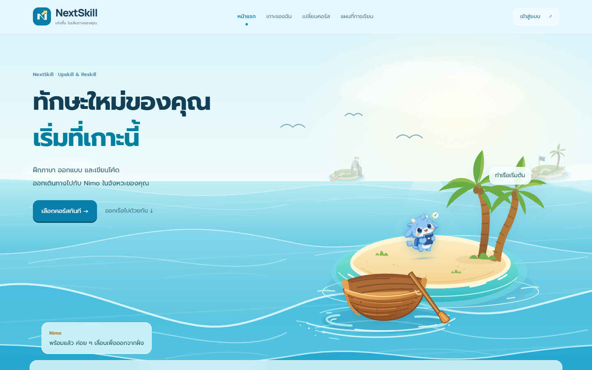
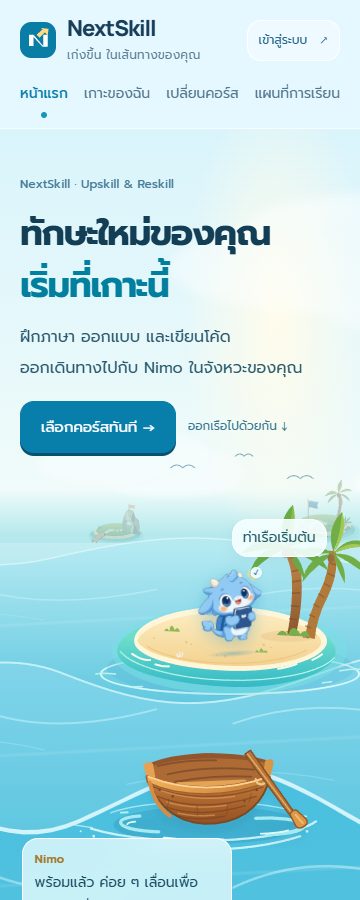
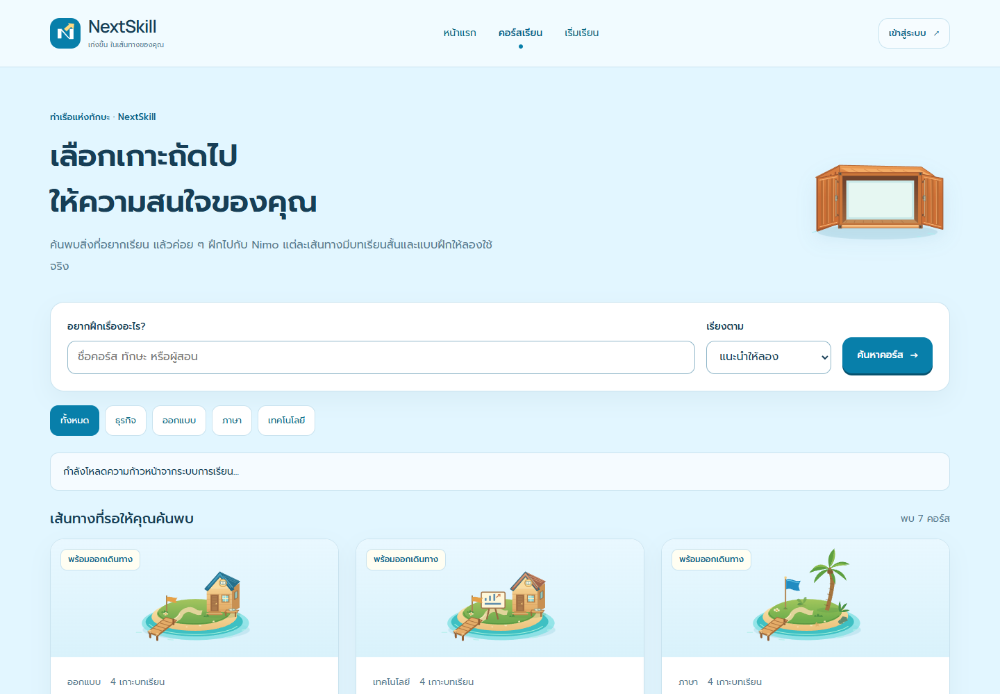
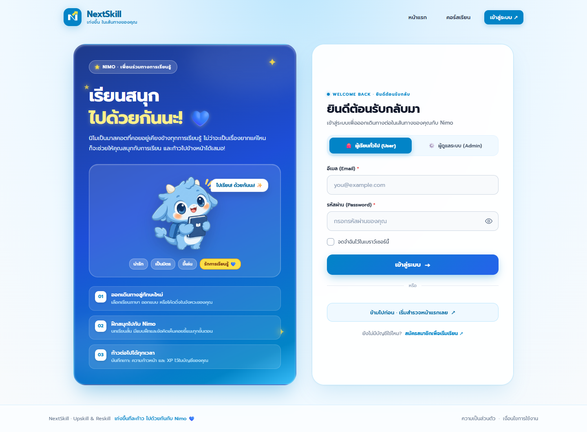

# ภาพอ้างอิงและ asset manifest

รวมภาพจาก repository ต้นทางในแพ็กวันที่ 1 พฤศจิกายน 2026 ภาพหน้าจอเป็น **ภาพบันทึกก่อนรอบนี้** ไม่ใช่ live QA ใหม่ ใช้ดูองค์ประกอบ/บุคลิกและความสัมพันธ์ระหว่างฉากกับเนื้อหา; กติกาสี/contrast และ source ปัจจุบันมีลำดับเหนือภาพ โดยเฉพาะภาพบัญชี baseline อาจยังมี component สีเก่า

Paths ต้นทางของ screenshot เริ่มจาก repository root; paths ของมาสคอตเริ่มจากโฟลเดอร์แอป

| ไฟล์ในแพ็ก | ต้นทาง | ใช้ดู |
|---|---|---|
| `assets/references/home-desktop.png` | `artifacts/ux-qa/07-home-1440.png` | hero ทะเล, navy heading, CTA, Nimo/เรือ |
| `assets/references/home-mobile.png` | `artifacts/ux-qa/04-home-360.png` | ลำดับข้อความ/CTA และฉากบนมือถือ |
| `assets/references/courses-desktop.png` | `artifacts/ux-qa/01-courses-1440.png` | ฟ้าอ่อน, พื้นขาว, search/filter/cards |
| `assets/references/login-desktop.png` | `artifacts/ux-baseline/login-1440.png` | การแยก story panel กับแบบฟอร์ม; ภาพ baseline เก่ากว่า shared-token บางส่วน |
| `assets/mascot/nimo-learning.png` | `wwwroot/images/nimo-learning.png` | ภาพ active idle/เรียนของ Nimo |
| `assets/mascot/nimo-rowing.png` | `wwwroot/images/nimo-rowing.png` | pose พายเรือในระบบ singleton เดิม |

ยังไม่มี screenshot Admin ที่ตรวจยืนยันได้ในโฟลเดอร์ QA ที่พบ จึงไม่สร้างภาพจำลองแล้วเรียกว่าเว็บจริง ให้ดู `Views/Account/AdminDashboard.cshtml` และ tokens กลางจนกว่าทีมจะเพิ่มภาพจาก session ทดสอบที่เหมาะสม ไม่ต้องใช้บัญชีจริงเพื่อสร้างภาพอ้างอิงโดยอัตโนมัติ

อย่าคัดลอก PNG ไปแสดงมาสคอตตัวที่สองใน NextSkill ให้ reuse singleton/anchor เดิม ภาพเหล่านี้เป็นภาพอ้างอิง ไม่ได้บังคับให้โปรเจกต์ของเพื่อนเปลี่ยนแบรนด์หรือมีมาสคอตหากผู้ใช้ไม่ได้ขอ
